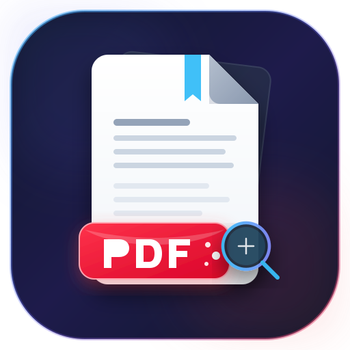

<p align="center">
  
</p>

<h1 align="center">MK PDF Reader</h1>

<p align="center">
  <b>A Fast, Ultra-Sharp &amp; Distraction-Free Android PDF Reader Built with Jetpack Compose &amp; Kotlin</b>
</p>

<p align="center">
  <a href="../../releases/latest">
    
  </a>
</p>

<p align="center">
  <a href="../../releases"></a>
  
  
  
  
  
  
</p>

---

## 💡 Why MK PDF Reader?

Most Android PDF readers today are bloated with full-screen advertisements, forced cloud logins, sluggish rendering engines, and subscription paywalls for basic features.

**MK PDF Reader** was engineered from scratch with a single vision: **delivering the cleanest, sharpest, and fastest reading experience on Android**. Whether you are reading heavy medical textbooks, scientific research papers, academic notes, novels, or financial sheets, MK PDF Reader provides razor-sharp text clarity, instantaneous page flipping, and zero distractions.

> **100% Private &amp; Offline**: No trackers, no telemetry, no network calls, and no accounts. Your documents never leave your device.

---

## 📥 Download &amp; Installation

Ready to try it out? You can download the ready-to-install APK directly from the **Releases** section of this repository:

1. Go to the [**Releases**](../../releases) tab (or click the **Download Latest APK** badge above).
2. Under **Assets**, download `app-release.apk` (or `app-debug.apk`).
3. Open the downloaded file on your Android device.
4. If prompted, allow *"Install unknown apps"* for your browser or file manager.
5. Launch **MK PDF Reader** and enjoy a seamless reading experience!

---

## ✨ Features &amp; Highlights

### 🔍 Ultra-Sharp Multi-Resolution Rendering Engine
- **Hardware-Accelerated Clarity**: Utilizes Android's native `PdfRenderer` pipeline with precision bitmap scaling.
- **3 Dynamic Sharpness Profiles**:
  - **Balanced (2.2x Scale)**: Ultra-fast rendering speed with low memory footprint and high battery efficiency.
  - **High Clarity (3.2x Scale)** *(Default)*: Crystal-clear vector rendering optimized for high-DPI smartphone and tablet screens.
  - **Ultra HD (4.8x Scale)**: 100% razor-sharp detail rendering for dense formulas, microscopic typography, and complex architectural schematics.

### ⚡ Predictive Background Pre-fetching &amp; Smart LRU Cache
- **Fluid Zero-Lag Scrolling**: Choose between **Aggressive (±2 Pages)** background pre-rendering, **Standard (±1 Page)**, or **On-Demand** rendering.
- **Intelligent Memory Management**: Automatic bitmap recycling and LRU caching prevent `OutOfMemory` errors even with 1,000+ page documents.
- **One-Tap Cache Flush**: Easily purge bitmap cache anytime directly from Reader Settings.

### 📖 Dual Reading Modes
- **Continuous Vertical Scroll**: Infinite, smooth vertical scrolling powered by Jetpack Compose `LazyColumn`. Perfect for documents, articles, code references, and textbooks.
- **Horizontal Pager Mode**: Classic flipbook-style page swiping with snappy pagination via `HorizontalPager`. Ideal for comics, manga, presentations, and magazines.

### 🔍 Precision Gesture Zoom &amp; Smart Column Fit
- **Smooth Pinch-to-Zoom**: Fluid magnification up to 5x+ with boundary clamping and momentum panning.
- **Double-Tap Smart Presets**:
  - **Smart Column Fit (Auto)**: Automatically analyzes page structure to fit double-column research papers without tedious horizontal panning.
  - **1.85x Compact**: Wide overview zoom for broad page layouts.
  - **2.08x Standard**: Tailored specifically for standard dual-column textbooks and literature.
  - **2.30x Large Text**: Maximum comfort for small print and dense tabular data.
  - **2.60x Ultra Close**: High magnification for inspection of diagrams, charts, and figures.
- **Quick Controls**: Instant Zoom In, Zoom Out, and Reset Zoom buttons.

### 🌿 Eye-Care Page Color Tones
- **Default (White Paper)**: Original PDF presentation and colors.
- **Warm Sepia**: Gentle, eye-friendly parchment tint designed to reduce blue light and eye strain during late-night study sessions.
- **Night Inverted (AMOLED Dark)**: Reverses white page backgrounds to pure true black while preserving text contrast, saving battery life on OLED screens and preventing glare in the dark.
- **Monochrome High Contrast**: Enhances legibility for faded, washed-out, or low-contrast document scans.

### 📑 Interactive Outlines (Table of Contents) &amp; Bookmarks
- **Hierarchical Document Outlines**: Full TOC tree navigation supporting nested chapters, sections, and subheadings with one-tap jump.
- **Room-Backed Bookmarks**: Save pages with custom titles and personal reading notes stored permanently in a local SQLite database.
- **Fast Management**: Easily browse, edit notes, or delete bookmarks anytime via the sliding sheet.

### 🚀 Instant Page Navigation &amp; Document Info
- **Live Scrubbing Slider**: Smooth bottom slider with real-time `Page X / Y` badge feedback.
- **Jump to Page Dialog**: Direct numerical input dialog to instantly jump to any page in large PDFs.
- **Document Metadata Inspector**: View document title, author, creation date, total pages, file size, page dimensions, and storage path.

### 🕶️ Distraction-Free Reading &amp; Ergonomics
- **One-Tap Fullscreen**: Hides the status bar, navigation bar, and top/bottom toolbars for an edge-to-edge, book-like reading immersion.
- **Screen Keep-Awake**: Prevent screen timeout during long reading sessions with customizable timers (**5 min**, **15 min**, **30 min**, or **Always On**)—ideal for musicians reading sheet music, cooks reading recipes, or students studying.
- **Orientation Control**: Lock orientation to **Portrait**, **Landscape**, or follow system **Auto-Rotate**.
- **Custom Page Spacing**: Adjust vertical separation between pages (**Compact 6dp**, **Standard 14dp**, or **Spacious 24dp**).

### 📚 Modern Library Hub &amp; Recent Documents
- **Flexible Layouts**: Toggle between **Grid View** and **List View** with high-resolution page thumbnails.
- **Instant Search &amp; Filter**: Search through your recent library in real-time by document name.
- **Reading Progress Tracking**: Automatically remembers your last read page, reading progress percentage, and access timestamps.
- **Built-in Demo Guide Generator**: Generates an interactive multi-page PDF sample with one tap so you can test features right after installation.
- **Universal File Access**: Supports both Android's secure Storage Access Framework (SAF) and optional All Files Access for instant device-wide scanning.

### 🎨 Material Design 3 &amp; AMOLED Theming
- **Dynamic Theming**: Full support for Material 3 design tokens.
- **4 Theme Choices**: **System Default**, **Light Mode**, **Dark Mode**, and **Pure AMOLED Dark**.

---

## 📱 Screenshots &amp; Visual Tour

<div align="center">
  <table style="border: none; text-align: center;">
    <tr>
      <td><b>Library (Grid / List)</b></td>
      <td><b>Ultra-Sharp Reader</b></td>
      <td><b>Sepia &amp; AMOLED Tones</b></td>
    </tr>
    <tr>
      <td></td>
      <td></td>
      <td></td>
    </tr>
    <tr>
      <td><i>Recent documents, search &amp; grid/list toggle</i></td>
      <td><i>Continuous scroll, zoom presets &amp; page jumper</i></td>
      <td><i>Eye-care sepia, night inverted &amp; outlines</i></td>
    </tr>
  </table>
</div>

---

## 🛠️ Tech Stack &amp; Architecture

MK PDF Reader is developed following modern Android development best practices and Clean Architecture:

| Component | Technology | Description |
|---|---|---|
| **Language** | [Kotlin](https://kotlinlang.org/) | 100% Kotlin codebase |
| **UI Framework** | [Jetpack Compose](https://developer.android.com/jetpack/compose) | Declarative UI with reactive state management |
| **Design System** | [Material Design 3](https://m3.material.io/) | M3 ColorScheme, Typography, Shapes &amp; Components |
| **PDF Engine** | Android `PdfRenderer` | Hardware-accelerated native PDF vector rasterization |
| **Local Storage** | [Room Database](https://developer.android.com/training/data-storage/room) | SQLite-backed persistence for bookmarks and recents |
| **Concurrency** | Kotlin Coroutines &amp; Flow | Non-blocking async rendering and disk I/O |
| **State Management** | `ViewModel` + `StateFlow` | Predictable unidirectional data flow (UDF) |
| **Settings** | SharedPreferences / Repository | Fast, reactive configuration persistence |

---

## 🏗️ Building from Source

If you want to build or modify the app yourself:

### Prerequisites
- **Android Studio**: Ladybug / Meerkat (2024.2+) or later
- **JDK**: OpenJDK 17 or higher
- **Android SDK**: Compile SDK 35, Min SDK 26 (Android 8.0 Oreo+)

### Steps
1. **Clone the repository:**
   ```bash
   git clone https://github.com/USERNAME/mk-pdf-reader.git
   cd mk-pdf-reader
   ```

2. **Open in Android Studio:**
   - Launch Android Studio and select **Open**.
   - Navigate to the cloned folder and click **OK**.
   - Allow Gradle to sync dependencies.

3. **Build the APK:**
   - Via Android Studio: `Build > Build Bundle(s) / APK(s) > Build APK(s)`
   - Via Command Line:
     ```bash
     gradle assembleDebug
     ```
   - The compiled APK will be generated at:
     ```
     app/build/outputs/apk/debug/app-debug.apk
     ```

---

## 🤝 Contributing

Contributions, feedback, and feature suggestions are warmly welcomed!

- Found a bug or have an idea? Open an [**Issue**](../../issues).
- Want to contribute code? Fork the repo, create a feature branch, and submit a [**Pull Request**](../../pulls).

---

## 📄 License

This project is licensed under the **Apache License 2.0**. See the [LICENSE](LICENSE) file for full details.

---

<p align="center">
  Made with ❤️ for book lovers, students, and productivity enthusiasts.
  <br>
  <b><a href="../../releases/latest">Download the latest release now</a></b>
</p>
